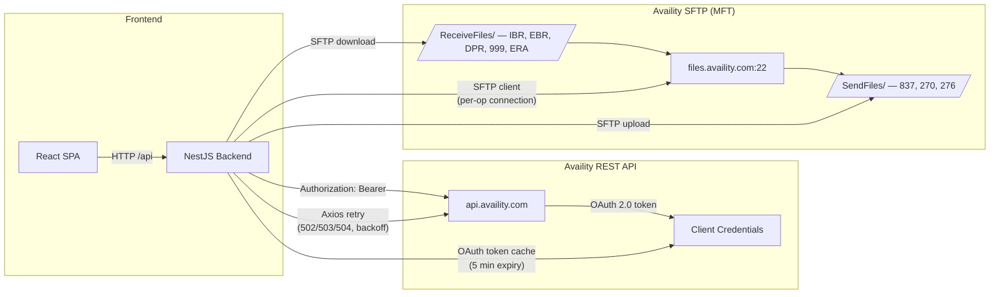
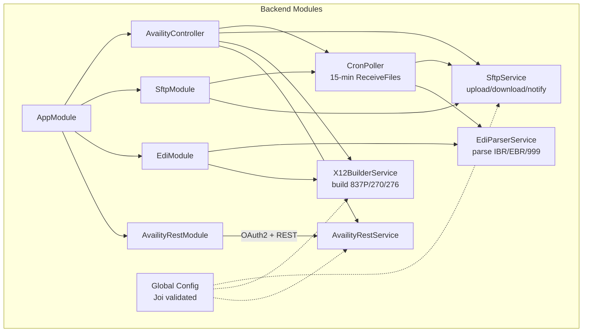
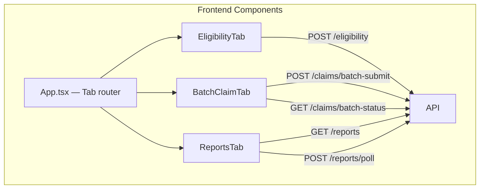
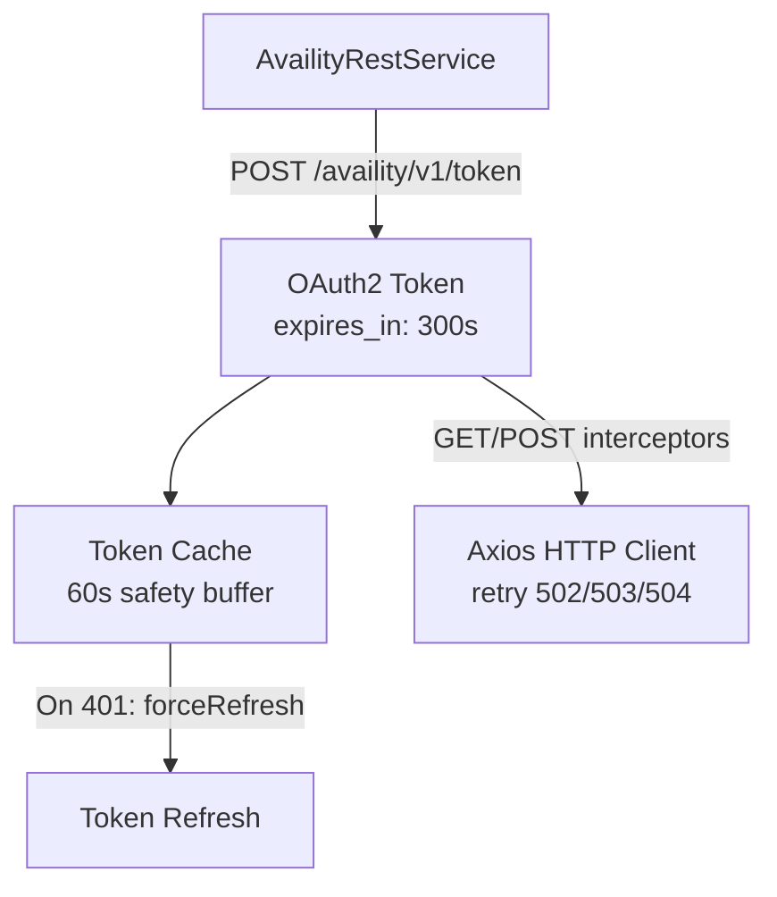
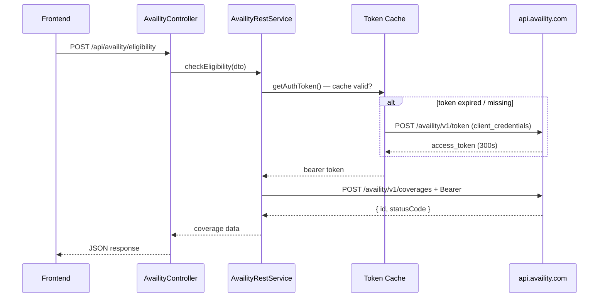
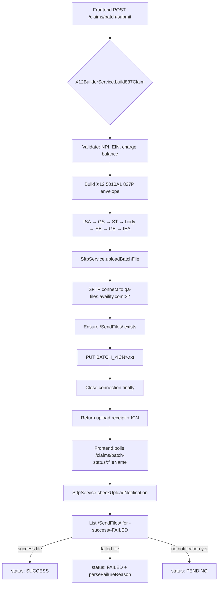
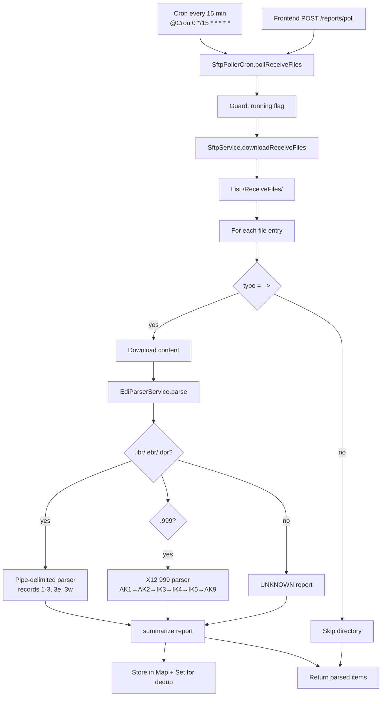
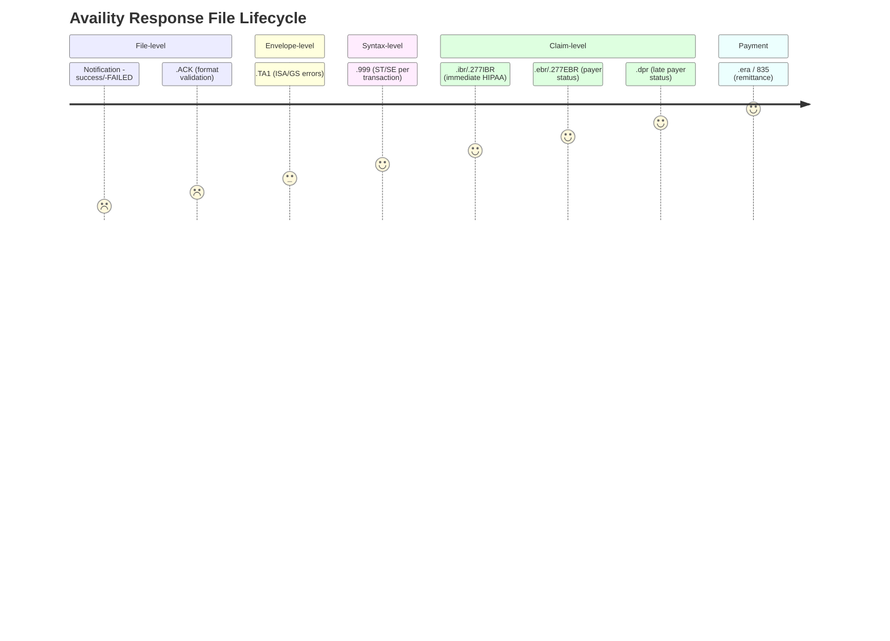

# Availity Clearinghouse Integration POC

A full-stack proof-of-concept for integrating a healthcare clearinghouse (Availity) into a claims-processing pipeline. The project demonstrates the **complete closed-loop workflow**: submit real-time eligibility checks over REST, build and batch-submit 837 professional claims over SFTP, poll for acknowledgment/response files, parse those responses, and surface everything through a React/Vite admin dashboard.

> **Reference:** [`availity-integration-guide.md`](./availity-integration-guide.md) summarizes Availity case 18993019 and the Batch EDI Standard Companion Guide. The EDI guide file itself is not in this repo. Items the guide does not answer are listed in [`OPEN_QUESTIONS.md`](./OPEN_QUESTIONS.md).

## Confirmed vs unconfirmed

Confirmed by the case summary and the companion-guide notes in this repo:

- SFTP is `qa-files.availity.com` (QA) or `files.availity.com` (production), port 22. Upload folder `/SendFiles`, download folder `/ReceiveFiles`.
- 837 submission and 835 retrieval are batch EDI over SFTP. There is no documented webhook; the poller is the only file-discovery path.
- Real-time eligibility uses `POST /availity/v1/coverages` and, when `statusCode` is `0`, polls `GET /availity/v1/coverages/{id}` until `3` or `4`.
- Standard claim status uses `POST /v1/claim-statuses` and `GET /v1/claim-statuses/{id}`.
- ISA/GS delimiters are `*`, `:`, `~`, and `^`. ISA15 is `T` on QA and `P` in production. A mismatched host and indicator refuses to build unless `AVAILITY_ALLOW_ENV_MISMATCH=true`.
- Interchange control numbers are persisted outside Jest so a restarted process does not reuse ISA13.

Unconfirmed, and not guessed in code:

- The exact pipe-delimited column order beyond the rows this parser already accepts (patient, date, control number, charge, billing id, status, then 3e/3w/3a/3c notes).
- Which payer IDs mean Medicare for the SSN edit, and which procedure codes require CR5 or CR6. Those claims are rejected when the caller sets `oxygenTherapy` or `homeHealth`.
- Whether the OAuth path is `/availity/v1/token` (what this POC calls, and what answered the sandbox) or `/v1/token` (the curl in the integration guide).

---

## Table of Contents

1. [Process and API map](#process-and-api-map)
2. [Background — Why Two Paths?](#background---why-two-paths)
3. [Architecture Overview](#architecture-overview)
4. [Project Structure](#project-structure)
5. [Technology Stack](#technology-stack)
6. [Prerequisites](#prerequisites)
7. [Quick Start](#quick-start)
8. [Configuration](#configuration)
9. [Backend API Reference](#backend-api-reference)
10. [Data Flows](#data-flows)
11. [Testing](#testing)
12. [Frontend](#frontend)
13. [Key Concepts Glossary](#key-concepts-glossary)

---

## Process and API map

| Process | Application API | Availity API / Channel | How it works |
|---|---|---|---|
| OAuth Authentication | Internal service call | `POST /availity/v1/token` | Client credentials → cache token → refresh before expiry → retry once on 401 |
| Real-time Eligibility | `POST /api/availity/eligibility` | `POST /availity/v1/coverages`, then `GET /availity/v1/coverages/{id}` | Submit inquiry → poll while `statusCode=0` → return benefits at `3` or `4` |
| 837P Claim Submission | `POST /api/availity/claims/batch-submit` | SFTP `/SendFiles` | Validate claim → generate X12 837P → upload `BATCH_<ICN>.txt` |
| Upload Notification | `GET /api/availity/claims/batch-status/:fileName` | SFTP `/SendFiles` | Poll for `<file>-success` or `<file>-FAILED`; parse failure reason |
| Inbound Reports | `POST /api/availity/reports/poll`, `GET /api/availity/reports` | SFTP `/ReceiveFiles` | Poll/download → deduplicate → parse IBR, IBRP, EBR, DPR, 999 and TA1 → display reports |
| Claim Status | `POST /api/availity/claim-status`, `GET /api/availity/claim-status/:id` | `POST /v1/claim-statuses`, `GET /v1/claim-statuses/{id}` | Submit claim-status inquiry → receive ID → retrieve latest result |
| ERA / 835 | No application API yet | SFTP `/ReceiveFiles` | Available after payer enrollment; complete 835 parser is not implemented |
| SFTP Environments | Internal SFTP service | QA: `qa-files.availity.com:22`, Prod: `files.availity.com:22` | Fresh connection per operation using password or private key; always closed afterward |

---

## Background — Why Two Paths?

Availity offers **two non-overlapping integration families**. They are not alternatives for the same task — different transaction sets are only available on different channels:

| Transaction | Batch EDI (SFTP) | Healthcare HIPAA REST APIs |
|---|---|---|
| Claim submission (837P/I/D) | ✅ The only way | ❌ No REST 837 submission product exists |
| Remittance / ERA (835) | ✅ Once per-payer enrolled | ❌ Remittance Data API is closed beta |
| Claim status (276/277) | ✅ Via batch | ✅ Standard Claim Statuses API (real-time) |
| Eligibility (270/271) | Possible but rarely used | ✅ Coverages API (real-time) |
| Auth / referral (278) | ✅ Via batch | ✅ Service Reviews API |
| Auth model | SFTP username/password | OAuth 2.0 client-credentials bearer token |
| Volume model | Bulk files, near-real-time | Real-time, one call per request |

**For Delphi's PR-first allocation + payment waterfall engine**, the core dependency — submitting claims and receiving remittances — must go through **Batch EDI over SFTP**. The REST APIs are used only for real-time eligibility (already working) and real-time single-claim status lookups.

**Common pitfalls this POC avoids** (see the integration guide for full details):

- `POST /availity/v1/professional-claims` is the Patient Cost Estimator, **not** claim submission.
- SFTP host is `files.availity.com` (prod) / `qa-files.availity.com` (QA), **not** `sftp.availity.com`.
- Enhanced Claim Status (`.../clmsmgmt/claim-status/.../searchBy276`) is a paid add-on not available on Demo keys. Use `POST /v1/claim-statuses` instead.
- Availity Remittance Data API is in closed beta — ERAs arrive only via SFTP `ReceiveFiles`.

---

## Architecture Overview









**Key design decisions:**

1. **OAuth token caching** — The Availity REST API issues tokens valid for only 5 minutes. `AvailityRestService` caches the token and refreshes proactively, with a 60-second safety buffer.
2. **SFTP connection per operation** — `SftpService` opens a fresh SFTP connection for each upload/download and always closes it in a `finally` block, preventing connection leaks.
3. **In-memory report store** — `SftpPollerCron` keeps parsed reports in a `Map` for the duration of the process, allowing the frontend to query without a database. (Marked as a POC simplification — production would use persistent storage.)
4. **Resilient parsing** — `EdiParserService` handles both Availity pipe-delimited reports (IBR/EBR/DPR) and X12 999 acknowledgments, recording per-row errors instead of failing on the first malformed line.
5. **Input validation first** — `claim-input.dto.ts` validates NPI checksums, EIN format, and that service-line charges sum to the claim total before any X12 is generated.

---

## Project Structure

```
POC-availity/
├── README.md                              # This file
├── availity-integration-guide.md          # Detailed Availity vendor documentation
├── .gitignore
├── backend/                               # NestJS backend application
│   ├── package.json
│   ├── nest-cli.json
│   ├── tsconfig.json
│   ├── tsconfig.build.json
│   ├── .env.example                       # Template for environment variables
│   ├── .env                               # (gitignored) Active environment config
│   ├── src/
│   │   ├── main.ts                        # Bootstrap: CORS, global ValidationPipe
│   │   ├── app.module.ts                  # Root module — imports 3 feature modules
│   │   ├── config/
│   │   │   └── availity.config.ts         # Global ConfigModule + Joi schema
│   │   ├── availity-rest/                 # REST API client module
│   │   │   ├── availity-rest.module.ts
│   │   │   ├── availity-rest.service.ts   # OAuth2 token, eligibility, claim-status
│   │   │   ├── availity-rest.service.spec.ts
│   │   │   └── dto/
│   │   │       ├── coverage-inquiry.dto.ts
│   │   │       └── claim-status-query.dto.ts
│   │   ├── edi/                           # X12/EDI module
│   │   │   ├── edi.module.ts
│   │   │   ├── edi-parser.service.ts      # Parse IBR/EBR/DPR/999 response files
│   │   │   ├── edi-parser.service.spec.ts
│   │   │   ├── x12-builder.service.ts     # Build 270/276/837P X12 messages
│   │   │   ├── x12-builder.service.spec.ts
│   │   │   └── dto/
│   │   │       ├── eligibility-query.dto.ts  # 270 input DTO
│   │   │       └── claim-input.dto.ts        # 837P input DTO (NPI/EIN validation)
│   │   ├── sftp/                          # SFTP / Batch EDI module
│   │   │   ├── sftp.module.ts
│   │   │   ├── sftp.service.ts            # Upload, download, notification check
│   │   │   ├── sftp.service.spec.ts
│   │   │   ├── sftp-poller.cron.ts        # @Cron polls /ReceiveFiles every 15 min
│   │   │   └── sftp-poller.cron.spec.ts
│   │   ├── controllers/
│   │   │   ├── availity.controller.ts     # REST endpoints for the frontend
│   │   │   └── availity.controller.spec.ts
│   │   └── common/
│   │       └── mock-data.seed.ts          # Sample EDI data for tests/e2e
│   ├── test/
│   │   ├── jest-e2e.json
│   │   ├── e2e-env.ts                     # E2E test environment
│   │   └── availity-poc.e2e-spec.ts       # End-to-end workflow tests
│   └── dist/                              # (gitignored) Compiled output
├── frontend/                              # React + Vite admin dashboard
│   ├── package.json
│   ├── vite.config.ts
│   ├── tailwind.config.js
│   ├── tsconfig.json
│   ├── postcss.config.js
│   └── src/
│       ├── main.tsx
│       ├── App.tsx                        # Tab navigation: Eligibility, Batch, Reports
│       ├── index.css
│       ├── vite-env.d.ts
│       ├── lib/
│       │   └── api.ts                     # Fetch wrapper with error handling
│       └── components/
│           ├── ui.tsx                     # Shared UI primitives (Badge, Spinner, etc.)
│           ├── EligibilityTab.tsx       # Real-time eligibility inquiry form
│           ├── BatchClaimTab.tsx         # 837P builder + upload + notification polling
│           └── ReportsTab.tsx            # Display parsed IBR/EBR/999 reports
└── coverage/                              # (gitignored) Test coverage reports
```

---

## Technology Stack

### Backend (NestJS)

| Layer | Technology |
|---|---|
| Runtime | Node.js (>= 18) |
| Framework | NestJS 10.x |
| HTTP client | Axios (with interceptor-based retry & token refresh) |
| SFTP client | `ssh2-sftp-client` (v9) |
| EDI parsing | `x12-parser` (installed; custom parser in `edi-parser.service.ts` also handles Availity pipe-delimited formats) |
| Validation | `class-validator` + `class-transformer` |
| Config | `@nestjs/config` with Joi schema validation |
| Task scheduling | `@nestjs/schedule` (cron-triggered `SftpPollerCron`) |
| API docs | `@nestjs/swagger` |
| Testing | Jest (unit) + Jest (e2e via `test/`) |
| Linting | ESLint + Prettier |
| Date handling | Native `Date` with custom `YYYYMMDD`/`HHMM` formatters |

### Frontend (React + Vite)

| Layer | Technology |
|---|---|
| Framework | React 18 (with `react-hooks`) |
| Build | Vite 6.x (ESM, TypeScript) |
| Styling | Tailwind CSS 3.x (with custom Availity blue color palette) |
| HTTP | Native `fetch` via `lib/api.ts` wrapper |
| Icons | Lucide React |
| Utility | clsx + tailwind-merge |

### Availity Services Used

| Service | Host | Port | Auth | Environment |
|---|---|---|---|---|
| REST API | `api.availity.com` | 443 | OAuth 2.0 client-credentials | Shared (QA uses same base URL) |
| Token endpoint | `api.availity.com/availity/v1/token` | 443 | client_id + client_secret | Shared |
| SFTP (QA) | `qa-files.availity.com` | 22 | username/password or private key | QA |
| SFTP (Prod) | `files.availity.com` | 22 | username/password or private key | Production |

---

## Prerequisites

- **Node.js** >= 18
- **npm** (bundled with Node.js) or **yarn**
- **Availity SFTP credentials** for QA (`qa-files.availity.com`)
- **Availity API credentials** (Demo/Sandbox key + secret, or production if provisioned)
- **Git** (for cloning)

---

## Quick Start

### 1. Clone and install dependencies

```bash
git clone <repo-url>
cd POC-availity

# Backend
cd backend
cp .env.example .env
npm install

# Frontend
cd ../frontend
npm install
```

### 2. Configure environment

Edit `backend/.env` with your credentials (see [Configuration](#configuration) below):

```bash
cd backend
# Edit .env with your Availity SFTP and REST credentials
```

### 3. Start both servers (two terminals)

```bash
# Terminal 1 — Backend
cd backend
npm run start:dev      # NestJS in watch mode, port 3000

# Terminal 2 — Frontend
cd frontend
npm run dev            # Vite dev server, port 5173
```

### 4. Open the dashboard

Navigate to `http://localhost:5173`. The Vite dev server proxies `/api` requests to the backend at `http://localhost:3000`.

---

## Configuration

Backend configuration is driven by environment variables validated at startup through a Joi schema in `src/config/availity.config.ts`. Copy `.env.example` to `.env` and fill in your values.

### Environment variables reference

| Variable | Default | Description |
|---|---|---|
| `AVAILITY_CLIENT_ID` | `sandbox` | Availity REST API client ID |
| `AVAILITY_CLIENT_SECRET` | `sandbox` | Availity REST API client secret |
| `AVAILITY_REALM` | *(empty)* | OAuth realm (optional) |
| `AVAILITY_SCOPE` | `hipaa` | OAuth scope — HIPAA transactions |
| `AVAILITY_BASE_URL` | `https://api.availity.com` | REST API base URL |
| `AVAILITY_TOKEN_URL` | `https://api.availity.com/availity/v1/token` | OAuth token endpoint |
| `AVAILITY_API_VERSION` | `v1` | API version |
| `AVAILITY_SUBMITTER_ID` | `AV09311993` | EDI submitter ID (used in ISA06/GS06) |
| `AVAILITY_RECEIVER_ID` | `030240928` | Availity's D&B number (ISA08) |
| `AVAILITY_USAGE_INDICATOR` | `T` | `T` = Test, `P` = Production |
| `AVAILITY_SFTP_HOST` | `qa-files.availity.com` | SFTP server host |
| `AVAILITY_SFTP_PORT` | `22` | SFTP server port |
| `AVAILITY_SFTP_USERNAME` | `sandbox` | SFTP username |
| `AVAILITY_SFTP_PASSWORD` | *(empty)* | SFTP password (mutually exclusive with private key) |
| `AVAILITY_SFTP_PRIVATE_KEY_PATH` | *(empty)* | Path to PEM private key file |
| `AVAILITY_SFTP_SEND_PATH` | `/SendFiles` | Upload directory (837s go here) |
| `AVAILITY_SFTP_RECEIVE_PATH` | `/ReceiveFiles` | Download directory (responses land here) |
| `AVAILITY_SFTP_INBOUND_PATH` | `/ReceiveFiles` | Alias for receive path |
| `AVAILITY_SFTP_OUTBOUND_PATH` | `/SendFiles` | Alias for send path |
| `PORT` | `3000` | Backend HTTP port |
| `NODE_ENV` | `development` | `development` \| `production` \| `test` |
| `LOG_LEVEL` | `debug` | `error` \| `warn` \| `info` \| `debug` |

### Environment switching

- **QA/Test:** Set `AVAILITY_SFTP_HOST=qa-files.availity.com` and `AVAILITY_USAGE_INDICATOR=T`
- **Production:** Set `AVAILITY_SFTP_HOST=files.availity.com`, `AVAILITY_USAGE_INDICATOR=P`, and provision real credentials

### Credential sources

1. **QA credentials** are provisioned through Availity Client Services. Your SFTP username/password is separate from your Essentials portal login.
2. **REST API keys** are provisioned through the Availity Developer Portal. The Demo key is rate-limited to 3 transactions per second / 500 per day.
3. **ERA enrollment** is per-payer and must be set up via the Availity payer list — it's separate from claim submission enrollment.

---

## Backend API Reference

All backend endpoints are prefixed with `/api/availity`.

### Real-time Eligibility (REST)

| Method | Path | Description |
|---|---|---|
| `POST` | `/eligibility` | Submit a 270/271 coverage inquiry via Availity REST API |

**Request body** (`CoverageInquiryDto`):

```json
{
  "payerId": "00001",
  "memberId": "MEM8941029",
  "serviceTypeCode": "30",
  "patientFirstName": "JOHN",
  "patientLastName": "DOE",
  "patientBirthDate": "1985-04-12",
  "patientGender": "M",
  "providerNpi": "1234567893"
}
```

**Response:** The raw Availity coverage response (plans array with copay/deductible/coinsurance, coverage status, etc.). Follows Availity's [asynchronous polling pattern](https://docs.availity.com): POST returns immediately with an `id`; GET the same ID to poll until `statusCode` is terminal.

### Claim Status (REST)

| Method | Path | Description |
|---|---|---|
| `POST` | `/claim-status` | Query a 276/277 claim status via Availity REST API |
| `GET` | `/claim-status/:id` | Retrieve a previously submitted claim status response |

**Request body** (`ClaimStatusQueryDto`):

```json
{
  "payerId": "00001",
  "providerNpi": "1234567893",
  "memberId": "MEM8941029",
  "patientFirstName": "JOHN",
  "patientLastName": "DOE",
  "patientBirthDate": "1985-04-12",
  "patientControlNumber": "PCN-2023-001",
  "serviceDate": "2026-09-10"
}
```

### Batch Claim Submission (SFTP + X12)

| Method | Path | Description |
|---|---|---|
| `POST` | `/claims/batch-submit` | Build a 837P file from input and upload to `/SendFiles/` |
| `GET` | `/claims/batch-status/:fileName` | Check for `-success` or `-FAILED` notification file |

**Request body** (`ClaimInputDto`) — the full 837P model:

```json
{
  "claimType": "professional",
  "tradingPartnerId": "00001",
  "claimControlNumber": "PCN-2023-001",
  "frequencyCode": "1",
  "billingProvider": {
    "npi": "1234567893",
    "taxId": "12-3456789",
    "name": "RIVERSIDE FAMILY CLINIC",
    "address1": "1200 RIVERPLACE BLVD",
    "city": "JACKSONVILLE",
    "state": "FL",
    "zip": "32207"
  },
  "renderingProvider": { "npi": "1234567893", "name": "CHEN" },
  "subscriber": {
    "memberId": "MEM8941029",
    "firstName": "JOHN",
    "lastName": "DOE",
    "dateOfBirth": "1985-04-12",
    "gender": "M",
    "address1": "88 OAK STREET",
    "city": "JACKSONVILLE",
    "state": "FL",
    "zip": "32202"
  },
  "diagnoses": [
    { "code": "J06.9" },
    { "code": "R05.9" }
  ],
  "serviceLines": [
    {
      "lineNumber": 1,
      "serviceDate": "2026-09-10",
      "procedureCode": "99213",
      "modifier1": "25",
      "quantity": 1,
      "unitPrice": 150,
      "diagnosisPointer": "1",
      "placeOfService": "11"
    }
  ],
  "totalCharge": 150
}
```

Validation rules enforced before building X12:
- **NPI:** Must be a valid 10-digit NPI with passing Luhn checksum.
- **Tax ID:** Must be a 9-digit EIN.
- **Charge balance:** `sum(quantity × unitPrice)` across all service lines must equal `totalCharge`.
- **Claim type:** Only `professional` (837P) is currently supported.
- **Max 50 service lines** per claim (per Availity's practical limit).

**Response:**

```json
{
  "fileName": "BATCH_000000001.txt",
  "remotePath": "/SendFiles/BATCH_000000001.txt",
  "byteSize": 1247,
  "uploadedAt": "2026-09-28T14:32:00.000Z",
  "status": "UPLOADED",
  "claimControlNumber": "PCN-2023-001",
  "interchangeControlNumber": "000000001",
  "statusUrl": "/api/availity/claims/batch-status/BATCH_000000001.txt"
}
```

### Inbound Reports (Polling)

| Method | Path | Description |
|---|---|---|
| `GET` | `/reports` | List all parsed reports from the last poll |
| `POST` | `/reports/poll` | Trigger an immediate poll of `/ReceiveFiles/` |

Reports include IBR (Institutional Claim Accept/Reject), EBR (payer-level status), DPR (late payer status), and 999 (functional acknowledgment). Each response is automatically parsed and summarized.

---

## Data Flows

### Flow 1: Real-time Eligibility Check (REST)



**Steps:**

1. Frontend `POST /api/availity/eligibility`
2. `AvailityRestService.getAuthToken()` → cache check (5-min expiry, 60s buffer) → if expired: `POST /availity/v1/token` (client_credentials grant)
3. `POST /availity/v1/coverages` (with Bearer token)
4. Availity returns `{ id, statusCode, ... }` → statusCode 0 = "In Progress" → client polls `GET /v1/coverages/{id}` → statusCode 3 or 4 = terminal → return full benefit details
5. Response returned through controller → frontend renders coverage

**Token refresh on 401:** The Axios response interceptor catches `401 Unauthorized`, forces a token refresh, retries the request once, and surfaces errors otherwise.

**Retry policy:** Server errors (502, 503, 504) are retried with exponential backoff (`baseDelayMs: 1000`, `maxDelayMs: 10000`, `maxRetries: 3`) with jitter.

### Flow 2: Batch Claim Submission (SFTP)



**Steps:**

1. Frontend `POST /api/availity/claims/batch-submit`
2. `X12BuilderService.build837Claim(dto)` → validates claim input (NPI, EIN, charge balance) → builds X12 5010A1 837P envelope: `ISA → GS → ST → [BHT, NM1×4, HL×3, N3, N4, DMG×2, REF, CLM, HI, ...] → SE → GE → IEA` → returns EDI string with `~` segment terminators
3. `SftpService.uploadBatchFile(filename.txt, edi)` → connects to SFTP (password or private key) → ensures `/SendFiles/` directory exists → puts the file → closes connection (`finally` block)
4. Frontend polls `GET /api/availity/claims/batch-status/:fileName` → `SftpService.checkUploadNotification()` → looks for `<filename>-success` or `<filename>-FAILED` in `/SendFiles/` → returns `{ status: "SUCCESS"|"FAILED"|"PENDING", errorDetails?, notificationFile? }`

**File naming:** `BATCH_<9-digit-interchange-control-number>.txt`. Availity returns notification files named `<original>-success` or `<original>-FAILED`, which are purged nightly.

**Notification parsing:** For `-FAILED` files, `parseFailureReason()` extracts the error from labels like `Error:`, `Reason:`, or `Message:` in the content, falling back to the first non-empty line.

> **837P envelope structure:** The `ISA` segment is fixed at 106 characters. Key fields: ISA06 = submitter ID (`AV09311993`), ISA08 = receiver ID (`030240928`), ISA11 = `^` (repetition separator), ISA12 = `00501`, ISA15 = usage indicator (`T`/`P`), ISA16 = `:` (component separator).

### Flow 3: Inbound Report Polling (Cron + Manual)



**Steps:**

1. `SftpPollerCron.pollReceiveFiles()` — runs on `@Cron('0 */15 * * * *')` (every 15 min) and on-demand via `POST /api/availity/reports/poll`
2. `SftpService.downloadReceiveFiles()` → lists `/ReceiveFiles/` → downloads each file (type `-` only, skips directories) → continues after individual file download failures
3. For each file, `EdiParserService.parse()` routes to the appropriate parser:
   - `.ibr`/`.ebr`/`.dpr` → pipe-delimited parser (record types 1=header, 2=payer, 3=claim, 3e=error, 3w=warning)
   - `.999` → X12 999 acknowledgment parser (AK1→AK2→IK3/IK4→IK5→AK9)
4. `EdiParserService.summarize()` produces a flat summary object
5. Results stored in in-memory `Map` (reports) + `Set` (seen files for dedup)
6. `GET /api/availity/reports` returns all parsed reports sorted by `modifiedAt` desc

**Deduplication:** Files are keyed by `fileName|byteSize|modifiedAt`. Re-polls skip already-processed files.

**Concurrency guard:** The `running` flag prevents overlapping polls if the previous 15-minute cycle hasn't finished.

### Flow 4: Response File Lifecycle (per Availity)



After you upload to `/SendFiles/`, Availity drops these files in `/ReceiveFiles/` (with the immediate notification optionally landing back in `/SendFiles/`):

| Stage | File | Description | Timing |
|---|---|---|---|
| 1 | Notification (`-success`/`-FAILED`) | File-level: did Availity recognize the file? | Seconds–minutes |
| 2 | `.ACK` | Proprietary format validation (malformed X12) | Minutes |
| 3 | `.TA1` | Envelope-level (ISA/IEA/GS errors, duplicate control numbers) | Minutes |
| 4 | `.999` | Syntax-level (ST/SE transaction set accept/reject) | Minutes |
| 5 | `.ibr`/`.ibrp`/`.277ibr` | Claim-level: HIPAA edits (minutes–24h) | Fast |
| 6 | `.ebr`/`.277ebr` | Claim-level: payer/trading-partner status (24–48h) | Slower |
| 7 | `.dpr` | Late-arriving payer status (up to 30 days) | Late |
| 8 | `.era` | Remittance advice (835) — feeds payment waterfall | Per payer cycle |

**Available in three formats:** pipe-delimited (machine-parseable), X12 277CA (`.277ibr`/`.277ebr`), or human-readable text (`.ibt`/`.ebt`). This POC uses pipe-delimited for IBR/EBR/DPR and X12 for 999s.

**Response file retention:** Notification files are purged from `SendFiles` nightly. Response files in `ReceiveFiles` are retained for 30 days (self-restorable for 6 months; Availity Client Services can retrieve older ones on request).

### 837P X12 Envelope Structure

```mermaid
graph TD
    ISA[ISA — Interchange Control Header<br/>106 chars, fixed fields]
    GS[GS — Functional Group Header]
    ST[ST — Transaction Set Header<br/>837 / 005010X222A1]
    BHT[BHT — Beginning of Hierarchical Transaction]
    HL1[HL — Billing Provider level]
    PRV[PRV — Billing Provider special]
    NM1_85[NM1 — Billing Provider Name (85)]
    N3[N3 — Billing address]
    N4[N4 — Billing city/state/zip]
    REF_EI[REF — Billing Tax ID (EI)]
    HL2[HL — Subscriber level]
    SBR[SBR — Subscriber responsibility]
    NM1_IL[NM1 — Insured (IL)]
    DMG1[DMG — Subscriber DOB/Gender]
    NM1_PR[NM1 — Payer (PR)]
    CLM[CLM — Claim level<br/>totalCharge, POS:B:frequency]
    HI[HI — Diagnosis codes<br/>ABK:code / ABF:code]
    REF_EA[REF — Patient Account (EA)]
    NM1_82[NM1 — Rendering Provider (82)]
    SV[SV1 — Service Line<br/>HC:CPT:modifier, charge, qty]
    DTP[DTP — Date of service (472)]
    SE[SE — Transaction Set Trailer]
    GE[GE — Functional Group Trailer]
    IEA[IEA — Interchange Control Trailer]

    ISA --> GS --> ST
    ST --> BHT
    BHT --> HL1 --> PRV --> NM1_85 --> N3 --> N4 --> REF_EI
    REF_EI --> HL2 --> SBR --> NM1_IL --> DMG1 --> NM1_PR
    NM1_PR --> CLM
    CLM --> HI
    CLM --> REF_EA
    CLM --> NM1_82
    CLM --> SV
    SV --> DTP
    SV --> SE
    SE --> GE --> IEA
```

---

## Testing

### Unit tests

```bash
cd backend
npm test              # Run all unit tests (Jest)
npm run test:watch    # Watch mode
npm run test:cov      # With coverage report
```

Test files:
- `edi-parser.service.spec.ts` — IBR, EBR, DPR, and 999 parsing with edge cases
- `x12-builder.service.spec.ts` — 837P envelope construction, NPI/EIN/validation rejection
- `sftp.service.spec.ts` — Upload, notification check, download with mocked SFTP
- `sftp-poller.cron.spec.ts` — Polling, deduplication, concurrency, error propagation

### End-to-end tests

```bash
cd backend
npm run test:e2e      # Jest with e2e config (test/jest-e2e.json)
```

The e2e suite (`test/availity-poc.e2e-spec.ts`) walks through 5 full workflows:
1. OAuth token request, caching, and refresh on 401
2. Real-time eligibility inquiry via REST
3. 837P claim build + SFTP upload + notification check
4. `/ReceiveFiles/` polling and parsing of simulated IBR/EBR/999 files
5. Claim status submission and retrieval via REST

All external services (Availity REST API, SFTP) are mocked — the e2e tests validate the application's internal wiring, not the vendor.

---

## Frontend

The frontend is a single-page React application built with Vite and styled with Tailwind CSS. It proxies API requests to the backend at `/api`.

### Pages / Tabs

| Tab | Component | Purpose |
|---|---|---|
| Eligibility | `EligibilityTab.tsx` | Form to submit real-time coverage inquiries; displays benefits in a structured view (copay, deductible, coinsurance, plan name) |
| Batch 837 Builder | `BatchClaimTab.tsx` | Form to build a professional claim (837P), upload to SFTP, and poll for Availity's success/failed notification |
| Live Reports | `ReportsTab.tsx` | Lists parsed IBR/EBR/DPR/999 reports from `/ReceiveFiles/`; filters by accepted/rejected; shows per-claim errors with segment/loop/element locations |

### Running the frontend

```bash
cd frontend
npm run dev        # http://localhost:5173
npm run build      # Production build
npm run preview    # Preview built output locally
```

---

## Key Concepts Glossary

- **Availity** — A healthcare clearinghouse that routes EDI transactions between providers and payers. Offers both batch SFTP (EDI) and REST API channels.
- **EDI (Electronic Data Interchange)** — Standard formats for healthcare transactions. Availity supports X12N formats like 837 (claims), 270/271 (eligibility), 276/277 (claim status), 835 (remittance), 278 (authorization).
- **837P** — The HIPAA X12 transaction set for professional claims. Version used in this POC: `005010X222A1`.
- **270/271** — X12 transaction pair for eligibility inquiry/response. In this POC, submitted via REST (`/v1/coverages`).
- **276/277** — X12 transaction pair for claim status inquiry/response. Available via both REST (`/v1/claim-statuses`) and batch SFTP.
- **835 (ERA)** — Remittance advice / Electronic Remittance Advice. Delivered via SFTP after per-payer ERA enrollment; feeds into payment waterfall logic.
- **X12 envelope** — The wrapper structure: ISA (interchange) → GS (functional group) → ST (transaction set) → ... → SE → GE → IEA. The ISA/GS must have specific fixed values for Availity (see integration guide §3.6).
- **ISA15 / Usage Indicator** — `T` for test (QA), `P` for production. Determines whether files are routed to payers.
- **Control numbers** — Unique identifiers: Interchange Control Number (ISA13), Group Control Number (GS06), Transaction Set Control Number (ST02), and per-claim Claim Control Number.
- **IBR/IBRP/EBR/DPR** — Availity-specific pipe-delimited report formats for per-claim accept/reject status at different stages (immediate, payer, late).
- **999 ACK** — X12 functional acknowledgment. Reports syntax-level errors per transaction set (IK3 segment errors, IK4 element errors, IK5 transaction status, AK9 group status).
- **TA1** — X12 interchange acknowledgment (envelope-level errors like duplicate control numbers).
- **OAuth 2.0 client-credentials** — The REST auth flow: exchange `client_id` + `client_secret` for a bearer token. Token expires in 5 minutes.
- **SFTP** — SSH File Transfer Protocol. Availity's MFT platform at `files.availity.com` (prod) / `qa-files.availity.com` (QA), port 22.
- **SendFiles** — The SFTP upload directory for outbound EDI files (837s, 270s, etc.).
- **ReceiveFiles** — The SFTP download directory where Availity delivers all response/report/ERA files.
- **Batch ID** — Availity's internal identifier for a submitted file (`YYYYMMDDHHMMSSSS` format). Required when contacting support.
- **Payer ID / Trading Partner ID** — The Availity-issued identifier for each insurance payer. Used in NM1*PR loops and as `tradingPartnerId` in API requests.
- **Provider NPI** — 10-digit National Provider Identifier with Luhn checksum validation.
- **Submitter ID** — The entity sending the EDI (e.g., `AV09311993` for this POC). Appears in ISA06 and GS06.
- **Receiver ID** — Availity's identifier (`030240928`, their D&B number). Appears in ISA08.
- **Dedup key** — The `fileName|byteSize|modifiedAt` composite key used by `SftpPollerCron` to skip already-processed files.
- **Claim charge balance validation** — The sum of all `quantity × unitPrice` values must equal `totalCharge`. Enforced by `ClaimChargeBalanceConstraint` before any X12 is generated.

---

## Additional Resources

- **[Availity Integration Guide](./availity-integration-guide.md)** — Full vendor documentation, account setup steps, envelope requirements, practical gotchas, operational reference, and open questions for Availity Client Services.
- **Availity System Status:** https://payernetworkstatus.availity.com/
- **Availity Maintenance Windows (ET):** Code changes Wed 9–11pm; infra Wed 11pm–Thu 1am; misc Sun 12–8am
- **Availity Support:** 800-282-4548 (always have your Batch ID ready)
